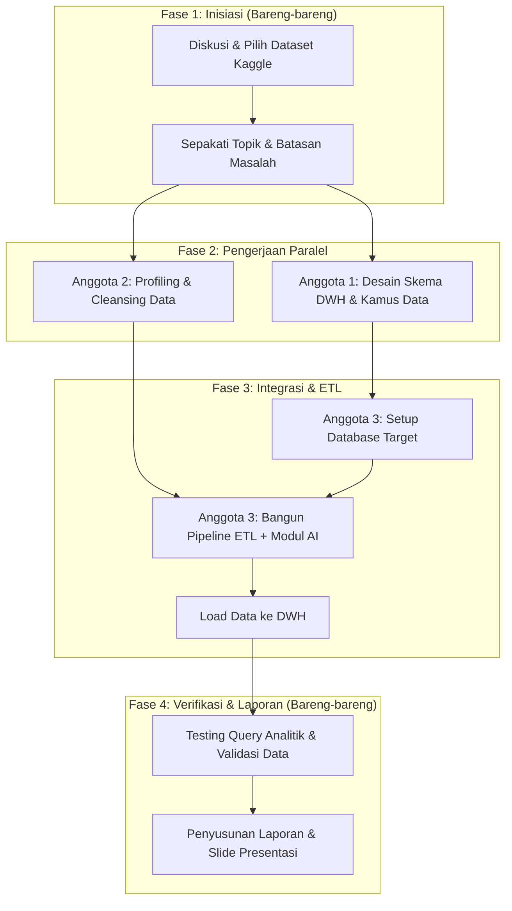

# 📋 Panduan Jobdesk & Alur Kerja Proyek Data Warehouse (DWH) & ETL

Dokumen ini berisi panduan pembagian tugas, tanggung jawab detail, dan urutan kerja untuk kelompok beranggotakan 3 orang dalam menyelesaikan proyek **Data Warehouse & AI-assisted ETL** berbasis dataset Kaggle.

---

## 🎯 Gambaran Umum Proyek
Alur proyek terdiri dari 5 tahapan utama:
1. **Dataset Hunting & Business Understanding:** Mencari dataset di Kaggle dan memahami proses bisnisnya.
2. **DWH Architecture & Modeling:** Merancang skema data warehouse (*Star / Snowflake Schema*).
3. **Data Profiling & Cleansing:** Mengaudit kualitas data dan membersihkan data kotor.
4. **AI-Driven ETL:** Membangun pipeline ekstraksi, transformasi dengan bantuan AI, dan loading ke database.
5. **Validation & Reporting:** Menjalankan query analisis dan menyusun laporan akhir.

> **Kesepakatan Teknis Kelompok:**
> * **Dataset:** [Brazilian E-Commerce Public Dataset by Olist (Kaggle)](https://www.kaggle.com/datasets/olistbr/brazilian-ecommerce)
> * **Target Database DWH:** **MySQL 8.x** (Nama database: `dwh_olist`, engine: `InnoDB`, charset: `utf8mb4`)
> * **Arsitektur Pemodelan:** Star Schema (Kimball Methodology) dengan skrip DDL di `sql/schema_dwh.sql`

---

## 👥 Profil & Rincian Tugas Anggota

### 1. 📐 Anggota 1 — Data Architect & Business Analyst
* **Fokus:** Konsep bisnis, pemodelan data dimensional, dan arsitektur DWH (Minim koding teknis).
* **Tingkat Kesulitan:** ⭐⭐☆☆☆ (Ringan ke Sedang - Tekor mikir konsep, santai dari debugging script).

#### Tanggung Jawab Utama:
* Memahami alur bisnis dari dataset yang dipilih (misal: siklus pemesanan barang di e-commerce dari checkout sampai barang diterima).
* Menentukan **Business Goals** dan metrik/KPI yang ingin dianalisis (contoh: tren revenue bulanan, analisis performa kurir, retensi pelanggan).
* Menentukan **Grain** (tingkat kedalaman/detail satu baris pada tabel fakta).
* Merancang **Star Schema** atau **Snowflake Schema**:
  * Menentukan **Fact Table** (berisi metrik numerik dan foreign key).
  * Menentukan **Dimension Tables** (berisi atribut kontekstual: waktu, pelanggan, produk, lokasi, dll).
* Membuat dokumen **Data Dictionary** (deskripsi kolom, tipe data, keterangan *Primary Key*, *Foreign Key*, dan *Surrogate Key*).
* Menyusun skrip DDL SQL (`CREATE TABLE ...`) untuk inisialisasi tabel target di DWH.

#### Deliverables (Output Nyata):
* [x] Diagram Alur Bisnis (*Business Process Flowchart*) di [`docs/business_process.md`](docs/business_process.md).
* [x] Diagram ERD DWH (*Star Schema*) di [`docs/dwh_schema_design.md`](docs/dwh_schema_design.md) & [`docs/images/star_schema.png`](docs/images/star_schema.png).
* [x] Dokumen Kamus Data (*Data Dictionary*) di [`docs/data_dictionary.md`](docs/data_dictionary.md).
* [x] File script `schema_dwh.sql` di [`sql/schema_dwh.sql`](sql/schema_dwh.sql).

---

### 2. 🧹 Anggota 2 — Data Quality & Cleansing Engineer
* **Fokus:** Audit kualitas data mentah (*Exploratory Data Analysis*) dan pembersihan data.
* **Tingkat Kesulitan:** ⭐⭐⭐☆☆ (Sedang - Koding Python/Pandas standar & manipulasi data).

#### Tanggung Jawab Utama:
* Memeriksa kondisi awal dataset dari Kaggle (*Data Profiling*):
  * Cek *missing values*, duplikasi data, nilai anomali/outlier, dan inkonsistensi tipe data.
* Menentukan aturan pembersihan data (*Cleansing Rules*):
  * Strategi penanganan nilai kosong (apakah di-*drop*, diisi nilai *default*, atau di-imputasi).
  * Standarisasi format tanggal/waktu (misal diseragamkan ke format `YYYY-MM-DD HH:MM:SS`).
  * Standarisasi teks (huruf besar/kecil, spasi berlebih, format nomor telepon/mata uang).
* Menulis skrip Python untuk data cleansing (menggunakan Pandas/Polars di Jupyter Notebook / script `.py`).
* Menyimpan hasil pembersihan ke folder **Staging / Cleaned Data** (format `.csv` atau `.parquet`).
* Menyusun laporan ringkasan kualitas data sebelum vs sesudah dibersihkan (*Before vs After Summary*).

#### Deliverables (Output Nyata):
* [x] Notebook & Skrip Python pembersihan data ([`src/cleansing/data_profiling.py`](src/cleansing/data_profiling.py), [`src/cleansing/data_profiling.ipynb`](src/cleansing/data_profiling.ipynb), [`src/cleansing/cleansing.py`](src/cleansing/cleansing.py)).
* [x] 7 File dataset bersih (*Cleaned Dataset*) siap olah di [`data/staging/`](data/staging/).
* [x] Laporan ringkas metrik pembersihan di [`docs/data_cleansing_report.md`](docs/data_cleansing_report.md).
* [x] Panduan Handover untuk Anggota 3 di [`PANDUAN_ANGGOTA_3.md`](PANDUAN_ANGGOTA_3.md).

---

### 3. ⚙️ Anggota 3 — AI-Driven ETL & Database Engineer
* **Fokus:** Pembangunan pipeline ETL, integrasi kecerdasan buatan (AI/LLM), dan eksekusi loading ke database target.
* **Tingkat Kesulitan:** ⭐⭐⭐⭐☆ (Tinggi - Rentan error dependency, relasi database, dan API AI).

#### Tanggung Jawab Utama:
* Setup Database target DWH menggunakan **MySQL 8.x** (membuat database `dwh_olist` secara lokal/server).
* Menjalankan skrip `schema_dwh.sql` dari Anggota 1 untuk membuat tabel-tabel di MySQL.
* Membangun script pipeline **ETL (Extract - Transform - Load)**:
  * **Extract:** Membaca data bersih dari Anggota 2.
  * **Transform:** Mengonversi data staging ke bentuk skema dimensional (memisahkan tabel fakta dan dimensi, men-generate *Surrogate Keys*).
  * **Integrasi AI:** Menyematkan komponen AI dalam proses transformasi (lihat contoh use case AI di bawah).
  * **Load:** Memasukkan data secara teratur ke database target tanpa melanggar *foreign key constraint*.
* Menangani error handling, logging eksekusi ETL, dan verifikasi integritas data setelah masuk ke database.

#### Contoh Integrasi AI dalam ETL (Pilih salah satu sesuai kebutuhan tugas):
1. **AI Categorization / Tagging:** Menggunakan API LLM (misal: OpenAI/Gemini/Groq/Ollama) untuk mengelompokkan kategori produk, feedback pelanggan, atau ulasan yang belum berlabel rapi.
2. **AI Text Normalization / Extraction:** Mengekstrak entitas penting dari kolom teks bebas (misal mengekstrak nama kota dari alamat lengkap yang acak).
3. **AI Anomaly & Data Quality Summary:** Menggunakan AI untuk mendeteksi baris transaksi mencurigakan dan memberikan penjelasan logis otomatis.

#### Deliverables (Output Nyata):
* [ ] Database target yang sudah terisi data (*Ready-to-query DWH*).
* [ ] Skrip pipeline ETL lengkap (`etl_pipeline.py` atau notebook modular).
* [ ] Modul fungsi integrasi AI (`ai_transformer.py`).
* [ ] Log eksekusi ETL yang membuktikan data berhasil di-load.

---

## 🔄 Urutan & Jadwal Pengerjaan (Step-by-Step Workflow)

### Langkah Kerja Rinci:

| Langkah | Aktivitas | Pelaksana | Dependensi / Syarat Mulai |
| :---: | :--- | :--- | :--- |
| **Step 1** | **Hunting Dataset di Kaggle** Cari dataset yang memiliki data transaksi dan data relasi (disarankan: E-commerce, Retail Sales, atau Hotel Booking). | Tim (Bersama) | - |
| **Step 2** | **Analisis Bisnis & Desain Skema DWH** Tentukan tabel fakta, dimensi, metrik, dan buat diagram Star Schema. Buat DDL SQL. | **Anggota 1** | Step 1 selesai |
| **Step 3** | **Data Profiling & Cleansing** Identifikasi kelemahan data mentah, tulis script pembersihan, hasilkan file data bersih. | **Anggota 2** | Step 1 selesai (jalan paralel dengan Step 2) |
| **Step 4** | **Setup Database & Inisialisasi Skema** Jalankan DDL dari Anggota 1 di database target (**MySQL 8.x**). | **Anggota 3** | Step 2 selesai |
| **Step 5** | **Implementasi Script ETL + Modul AI** Ambil data bersih dari Anggota 2, jalankan modul AI untuk transformasi, lalu load ke database. | **Anggota 3** *(didukung Anggota 2)* | Step 3 & Step 4 selesai |
| **Step 6** | **Verifikasi & Query Testing** Jalankan 3-5 query SQL analitik untuk membuktikan skema DWH berhasil menjawab kebutuhan bisnis. | Tim (Dipimpin Anggota 1) | Step 5 selesai |
| **Step 7** | **Finalisasi Laporan & Presentasi** Kompilasi dokumentasi desain, script cleansing, kode ETL, dan insight bisnis. | Tim (Bersama) | Step 6 selesai |

---

## 📊 Matriks Tanggung Jawab (RACI Matrix)

* **R (Responsible):** Pelaksana utama yang mengerjakan.
* **A (Accountable):** Penanggung jawab utama keberhasilan output.
* **C (Consulted):** Diajak diskusi/memberikan masukan.
* **I (Informed):** Cukup menerima update hasil akhir.

| Bagian Pekerjaan | Anggota 1 (Architect) | Anggota 2 (Cleansing) | Anggota 3 (ETL & AI) |
| :--- | :---: | :---: | :---: |
| Pemilihan Dataset Kaggle | A | R | R |
| Analisis Proses Bisnis & KPI | **R / A** | C | C |
| Desain Star/Snowflake Schema & DDL | **R / A** | C | C |
| Data Profiling & Identifikasi Kotoran Data | C | **R / A** | I |
| Script Data Cleansing | I | **R / A** | C |
| Setup Target Database | C | I | **R / A** |
| Pembuatan Prompt / Modul AI untuk ETL | C | C | **R / A** |
| Script Pipeline ETL (Extract, Transform, Load) | I | C *(bantu)* | **R / A** |
| Uji Coba Query SQL Analitik | **R / A** | C | C |
| Penyusunan Laporan Akhir & Slide | **R / A** | R | R |

---

## 🛠️ Rekomendasi Tech Stack & Tools

* **Data Modeling:** [dbdiagram.io](https://dbdiagram.io), Draw.io, atau Lucidchart.
* **Cleansing & Exploration:** Python (`pandas`, `numpy`, `missingno`, `jupyter notebook`).
* **Database Target DWH:** **MySQL 8.x** (Disepakati sebagai database target kelompok, database: `dwh_olist`, engine: `InnoDB`, charset: `utf8mb4`). Skrip DDL disiapkan di `sql/schema_dwh.sql`.
* **AI Transformation:** Python (`google-generativeai`, `openai`, `langchain`, atau lokal LLM via `ollama`).
* **Version Control & Kolaborasi:** GitHub / GitLab (buat 1 repository untuk kelompok).

---

## 💡 Tips Kerja Sama Tim
1. **Saling Komunikasi Antara Orang 1 & Orang 2:** Nama kolom di skema DWH (Orang 1) harus selaras dengan hasil pembersihan kolom oleh Orang 2 agar Orang 3 tidak bingung saat mapping ETL.
2. **Orang 2 Membantu Orang 3:** Karena beban Orang 3 paling berat (koding pipeline + AI + database), setelah pembersihan data selesai, Orang 2 sangat dianjurkan membantu Orang 3 membuat modul transformasi atau menyiapkan query database.
3. **Gunakan Sample Data Dulu:** Saat menguji AI di proses ETL, jangan langsung jalankan ke 100.000 baris data agar tidak kena limit kuota/token AI atau runtime lama. Uji coba dengan 10–50 baris terlebih dahulu.
