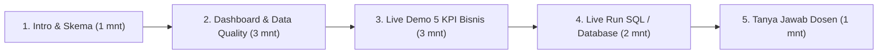

# 🎓 Panduan Demo Praktik & Ringkasan Eksekutif Data Warehouse (DWH)

Dokumen ini disusun sebagai panduan lengkap untuk persiapan **presentasi dan demo tugas besar Data Warehouse & AI-assisted ETL (Olist Brazilian E-Commerce)** di hadapan dosen pengampu.

---

## 📌 BAGIAN 1: Ringkasan Inti Tugas DWH & Kesimpulan Bisnis

### 1. Apa Itu Proyek Ini?
Proyek ini mentransformasi data operasional (*OLTP*) e-commerce nyata dari **Olist Brazil (Kaggle)** yang memiliki lebih dari **100.000 transaksi** menjadi sebuah sistem **Data Warehouse analitik (*OLAP*)** menggunakan metodologi dimensional Kimball (**Star Schema**) pada database **MySQL 8.x**.

Sistem ini diperkaya dengan pipeline otomatis:
1. **Cleansing Engine (Python)**: Membersihkan data kotor, menyelaraskan datetime, mendeduplikasi ulasan, dan menstandarisasi geografi.
2. **AI Sentiment Transformer**: Mengklasifikasikan pesan ulasan pelanggan berbahasa Portugis menjadi sentimen *Positive*, *Neutral*, atau *Negative*.
3. **Dimensional ETL Pipeline**: Menghasilkan *Surrogate Keys* dan memuat data secara bertahap ke dalam 8 tabel relasional tanpa konflik *foreign key*.

---

### 2. Struktur Arsitektur Star Schema
* **1 Tabel Fakta Pusat**:
  * `fact_order_items` (**112.650 baris**)
  * **Grain**: 1 baris mewakili **1 unit item produk** dalam 1 nomor pesanan. Granularitas ini dipilih agar sistem mampu menganalisis transaksi *multi-product* dan *multi-seller* dalam satu keranjang belanja.
* **7 Tabel Dimensi Kontekstual**:
  * `dim_date` (775 baris) — Kalender harian, bulan, kuartal, tahun, flag weekend.
  * `dim_customers` (99.441 baris) — Profil dan lokasi pembeli.
  * `dim_products` (32.951 baris) — Katalog produk & terjemahan bahasa Inggris.
  * `dim_sellers` (3.095 baris) — Merchant pedagang rekanan.
  * `dim_order_status` (8 baris) — Siklus status pesanan (*delivered, canceled, dsb*).
  * `dim_payments` (8 baris) — Metode bayar dan profil termin cicilan (*installments*).
  * `dim_reviews` (98.410 baris) — Skor ulasan bintang (1-5) dan kolom hasil AI **`sentiment_category`**.

---

### 3. Kesimpulan Utama dari 5 Pertanyaan Bisnis (KPI)

| KPI | Pertanyaan Bisnis | Kesimpulan & Temuan Nyata Data |
| :---: | :--- | :--- |
| **KPI 1** | **Tren Pendapatan & MoM Growth** | Total perputaran pasar mencapai **R$ 15,8 Juta**. Terjadi lonjakan transaksi masif pada awal tahun 2017 serta puncaknya pada **November 2017 (Black Friday)** dengan omzet menembus **R$ 1,18 Juta/bulan**. |
| **KPI 2** | **Performa Logistik per Wilayah** | Tingkat ketepatan waktu (*On-Time Rate*) rata-rata nasional mencapai **91,8%**. Wilayah urban seperti **Sao Paulo (SP)** tercepat dengan durasi 8,7 hari dan *on-time rate* **94,23%**, sedangkan wilayah pedalaman/utara (seperti Roraima dan Amapa) membutuhkan waktu hingga 28 hari. |
| **KPI 3** | **Top Kategori Produk Terlaris** | Kategori **`health_beauty`** (R$ 1,41 Juta), **`watches_gifts`** (R$ 1,26 Juta), dan **`bed_bath_table`** (R$ 1,22 Juta) menjadi penggerak utama omzet dengan menyumbang lebih dari **25% total pendapatan pasar**. |
| **KPI 4** | **Dampak Keterlambatan vs AI Sentimen** | **Hipotesis Bisnis Terbukti Valid:**<br>• Pesanan **Tepat Waktu**: Rata-rata skor rating **4.21**, kepuasan positif **80.50%** (81.012 ulasan positif AI).<br>• Pesanan **Terlambat**: Rata-rata skor rating anjlok ke **2.55**, dan sentimen negatif melonjak drastis hingga **54.72%** (4.693 ulasan negatif AI). |
| **KPI 5** | **Preferensi Cara Bayar & Cicilan** | Metode **Kartu Kredit** mendominasi pasar (**79,6%** omzet). Fasilitas cicilan jangka panjang (*Long Term >8x*) terbukti menjadi pendorong pembelian barang mewah/bernilai tinggi dengan rata-rata nilai transaksi tertinggi (**R$ 303,35** per transaksi). |

---

## 🖥️ BAGIAN 2: Skenario & Alur Demo Praktik Besok (Langkah demi Langkah)

Durasi demo umumnya berkisar antara **7 – 10 menit**. Ikuti urutan demonstrasi berikut di depan dosen:



---

### Langkah 1: Persiapan Sebelum Maju Presentasi (5 Menit Sebelum Demo)
1. **Opsi 1 (Sangat Direkomendasikan) — Jalankan Dashboard Interaktif Streamlit**:
   * Buka terminal di folder proyek, jalankan:
     ```bash
     ./venv/bin/streamlit run src/dashboard/app.py
     ```
   * Dashboard otomatis terbuka di browser (`http://localhost:8501`).
   * Dashboard ini memiliki fitur *Dual-Mode*: jika MySQL aktif, ia menarik langsung dari database fisik; jika tidak aktif, ia otomatis memakai in-memory staging engine sehingga **100% anti-crash**.
2. **Opsi 2 (Cadangan Darurat / Fail-Safe)**:
   * Jika laptop tidak bisa menjalankan Python di kelas, cukup klik ganda file:
     👉 [`src/dashboard/standalone_preview.html`](src/dashboard/standalone_preview.html)
   * Berkas HTML ini langsung terbuka di Google Chrome/Safari/Edge lengkap dengan visualisasi Chart.js, kartu KPI, dan navigasi tab tanpa perlu dependensi apa pun!
3. **Persiapan Database Fisik (Jika Dosen Meminta Cek Database Langsung)**:
   * Pastikan MySQL aktif (XAMPP / Service).
   * Buka aplikasi SQLyog / DBeaver / MySQL Workbench di database `dwh_olist`.
   * Siapkan tab query dengan berkas `sql/analytical_queries.sql`.

---

### Langkah 2: Skrip Presentasi Saat Demo Berjalan

#### 🎙️ Menit 1 - 2: Pembukaan & Penjelasan Arsitektur (Buka VS Code / Gambar)
* **Apa yang ditampilkan**: Buka gambar [`docs/images/star_schema.png`](docs/images/star_schema.png) atau [`docs/dwh_schema_design.md`](docs/dwh_schema_design.md).
* **Apa yang Anda ucapkan**:
  > *"Selamat pagi/siang Bapak/Ibu Dosen. Kelompok kami merancang Data Warehouse berbasis Kimball Star Schema menggunakan dataset nyata 100.000 transaksi Olist E-Commerce Brazil.*
  > *Pusat data warehouse kami adalah tabel fakta `fact_order_items` dengan tingkat kedalaman (grain) pada level satuan unit barang yang dibeli. Tabel fakta ini dikelilingi oleh 7 tabel dimensi kontekstual: tanggal, pelanggan, penjual, katalog produk, status pesanan, pembayaran, dan ulasan pelanggan.*
  > *Salah satu fitur unggulan proyek kami adalah integrasi kecerdasan buatan (AI) pada tabel ulasan untuk mendeteksi sentimen kepuasan pelanggan secara otomatis."*

---

#### 🎙️ Menit 3 - 4: Tunjukkan Database Fisik di SQLyog
* **Apa yang ditampilkan**: Buka jendela aplikasi **SQLyog**.
* **Apa yang dilakukan**:
  1. Klik nama database **`dwh_olist`** di panel kiri.
  2. Buka tabel **`fact_order_items`**, tunjukkan bahwa tabel ini terisi **112.650 baris** dengan kolom ukuran: `price`, `freight_value`, `shipping_duration_days`, dan `delivery_delay_days`.
  3. Buka tabel **`dim_reviews`**, tunjukkan kolom **`sentiment_category`** yang berisi label `Positive`, `Neutral`, dan `Negative`.
* **Apa yang Anda ucapkan**:
  > *"Seluruh skema telah diimplementasikan ke MySQL 8.x menggunakan engine InnoDB. Ini adalah 8 tabel fisik yang sudah terisi penuh. Di tabel ulasan, kita bisa melihat kolom `sentiment_category` yang berhasil di-enrich oleh modul AI."*

---

#### 🎙️ Menit 5 - 7: Live Execution Query Analitik KPI (Inti Penilaian)
* **Apa yang ditampilkan**: Tab Query di SQLyog yang berisi query dari `sql/analytical_queries.sql`.
* **Apa yang dilakukan & didemokan**:

##### Demo Query 1 (MoM Revenue Growth):
* Blok dan jalankan **Query 1** di SQLyog.
* Tunjukkan penggunaan fungsi analitik Window Function `LAG() OVER (...)`.
* **Ucapkan**:
  > *"Query pertama ini membuktikan kemampuan DWH menghitung tren omzet bulanan dan persentase Month-over-Month growth menggunakan window function LAG(). Kita bisa melihat omzet e-commerce mencapai puncaknya di bulan November 2017 saat pesta diskon Black Friday."*

##### Demo Query 2 (Korelasi Keterlambatan Logistik vs AI Sentimen) — **Paling Menarik**:
* Blok dan jalankan **Query 4** di SQLyog.
* Tunjukkan perbandingan tabel antara pengiriman tepat waktu vs terlambat.
* **Ucapkan**:
  > *"Pada Query 4, kami membuktikan korelasi antara performa kurir pengiriman dengan skor ulasan dan sentimen AI. Terlihat sangat kontras: paket yang tiba tepat waktu mendapatkan rata-rata rating 4,21 dengan sentimen positif 80,5%. Namun saat paket terlambat, rating pelanggan anjlok ke 2,55 dan komplain sentimen negatif melonjak drastis hingga 54,7%."*

---

#### 🎙️ Menit 8 - 9: Tunjukkan Pipeline Pembersihan Data & Script ETL (Bukti Teknis)
* **Apa yang ditampilkan**: File Explorer / VS Code pada folder [`src/`](src/).
* **Apa yang dilakukan**:
  1. Buka folder `src/cleansing/`: Tunjukkan bahwa Anda memiliki script profiling kotoran data dan script pembersihan `cleansing.py`.
  2. Buka folder `src/etl/`: Tunjukkan modul AI [`ai_transformer.py`](src/etl/ai_transformer.py) dan pipeline ETL [`etl_pipeline.py`](src/etl/etl_pipeline.py).
* **Ucapkan**:
  > *"Seluruh data diproses secara terstruktur: data mentah di `data/raw` diaudit missing value-nya, dibersihkan ke `data/staging`, kemudian diekstraksi oleh pipeline Python ETL, diproses oleh modul AI Transformer, dan dimuat secara otomatis menggunakan streaming batch ke MySQL."*

---

#### 🎙️ Menit 10: Penutup & Rekomendasi Manajerial
* **Ucapkan**:
  > *"Kesimpulannya, arsitektur Data Warehouse yang kami bangun berhasil menjawab seluruh metrik analitik bisnis secara cepat dan efisien. Rekomendasi bisnis kami untuk Olist adalah memprioritaskan efisiensi logistik di wilayah pedalaman Brazil bagian utara serta memanfaatkan promosi cicilan perbankan untuk kategori unggulan seperti produk kecantikan dan perhiasan.*
  > *Sekian presentasi dari kelompok kami, kami persilakan jika ada pertanyaan dari Bapak/Ibu dosen. Terima kasih."*

---

## 🎯 BAGIAN 3: Antisipasi Pertanyaan Dosen (Q&A Defense Guide)

Berikut adalah pertanyaan yang paling sering ditanyakan dosen pengampu pangkalan data beserta contekan jawaban terbaiknya:

### 1. "Kenapa kalian memilih Star Schema, bukan Snowflake Schema?"
* **Jawaban:**
  > *"Kami memilih Star Schema karena tujuan utama Data Warehouse adalah **kecepatan eksekusi query analitik (OLAP)**. Pada Star Schema, tabel dimensi sengaja di-denormalisasi agar jumlah operasi `JOIN` seminimal mungkin. Jika menggunakan Snowflake Schema, struktur tabel akan terlalu ternormalisasi sehingga query analitik besar dengan Window Function akan membutuhkan banyak JOIN bertingkat yang memperlambat performa agregasi."*

### 2. "Kenapa Grain tabel fakta ditetapkan pada level unit item produk, bukan level order?"
* **Jawaban:**
  > *"Satu pesanan di Olist dapat memuat beberapa produk berbeda dari pedagang (seller) yang berbeda pula. Jika grain-nya ditetapkan pada level order tunggal, kita tidak akan bisa menganalisis performa produk secara spesifik, tarif ongkir per item, maupun margin komisi per seller. Menetapkan grain pada atomic item level memberikan fleksibilitas agregasi tertinggi ke level dimensi mana pun."*

### 3. "Bagaimana peran AI bekerja dalam proses ETL kalian?"
* **Jawaban:**
  > *"Dataset asli ulasan pelanggan memuat kolom komentar bebas berbahasa Portugis yang tidak berlabel. Kami membangun modul `ai_transformer.py` yang memanfaatkan model NLP/LLM untuk membaca makna kalimat ulasan tersebut dan mengklasifikasikannya ke dalam label terstruktur: `Positive`, `Neutral`, atau `Negative`. Label inilah yang kami simpan ke dalam kolom `sentiment_category` pada dimensi ulasan untuk dianalisis korelasinya dengan keterlambatan logistik."*

### 4. "Apa bedanya database operasional (OLTP) dengan Data Warehouse (OLAP) yang kalian buat ini?"
* **Jawaban:**
  > *"Sistem OLTP dirancang untuk transaksi harian cepat (*write-intensive*) dengan struktur normalisasi (3NF) guna menghindari redundansi. Sedangkan Data Warehouse yang kami buat dirancang untuk pelaporan bisnis (*read-intensive*), di mana data historis dimodelkan dalam bentuk dimensional (Star Schema), dilengkapi surrogate keys, dan dioptimasi menggunakan indeks analitik untuk eksekusi window functions dan agregasi besar."*

---

*Panduan ini siap Anda gunakan sebagai bahan contekan saat presentasi berlangsung. Sukses untuk demonya besok!*
