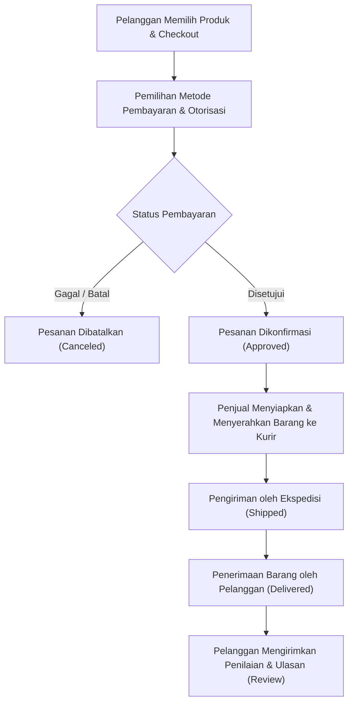

# Alur Proses Bisnis & Indikator Kinerja Utama (KPI)

Dokumen ini disusun oleh **Anggota 1 (Data Architect & Business Analyst)** sebagai dasar pemahaman proses bisnis e-commerce Olist Brazil dan penentuan metrik analitik target data warehouse.

---

## 1. Profil Domain Bisnis: Olist Brazilian E-Commerce

Olist adalah platform e-commerce marketplace integrator di Brazil yang menghubungkan pedagang kecil dan menengah (*sellers*) dengan berbagai pasar ritel besar. Pelanggan dari seluruh penjuru Brazil dapat memesan produk melalui platform, melakukan pembayaran, menerima barang lewat jaringan kurir, dan memberikan ulasan atas layanan yang diterima.

### Karakteristik Unik Dataset Olist:
1. **Multi-Seller dalam Satu Pesanan**: Satu pesanan (`order_id`) dapat memuat beberapa produk (`product_id`) yang dipenuhi oleh penjual (`seller_id`) yang berbeda.
2. **Multi-Payment Split**: Satu pesanan dapat dibayar menggunakan lebih dari satu metode pembayaran (misalnya kombinasi voucher dan kartu kredit).
3. **Siklus Logistik Lengkap**: Memiliki catatan waktu detail sejak pesanan dibuat, disetujui, diserahkan ke kurir, tanggal estimasi tiba, hingga tanggal pesanan diterima pelanggan.
4. **Ulasan Pelanggan**: Terdapat ulasan kepuasan pelanggan dengan skor 1 sampai 5 bintang beserta komentar bebas.

---

## 2. Diagram Alur Proses Bisnis (Business Process Flowchart)

Alur operasional transaksi pada Olist digambarkan dalam diagram berikut:

### Tahapan Detail Proses Bisnis:
1. **Pemesanan (Order Placement)**: Pelanggan membuat pesanan yang berisi item produk tertentu dengan tarif ongkos kirim (*freight value*).
2. **Pembayaran (Payment Processing)**: Sistem memproses transaksi pembayaran menggunakan kartu kredit, transfer bank (boleto), kartu debit, atau voucher.
3. **Pemenuhan & Pengemasan (Fulfillment)**: Penjual mengonfirmasi ketersediaan barang dan mengemas pesanan sesuai batas waktu pengiriman (*shipping limit date*).
4. **Logistik & Pengiriman (Shipping & Logistics)**: Mitra ekspedisi mengambil barang dan memperbarui tanggal serah terima kurir (*order_delivered_carrier_date*).
5. **Penyelesaian Transaksi (Delivery Completion)**: Barang tiba di alamat pelanggan (*order_delivered_customer_date*).
6. **Ulasan & Penilaian (Customer Feedback)**: Pelanggan mengisi formulir ulasan dengan rating skor 1 (sangat kecewa) hingga 5 (sangat puas).

---

## 3. Rumusan 5 Key Performance Indicators (KPI) Bisnis

Berdasarkan alur bisnis di atas, dirumuskan 5 KPI strategis yang akan dijawab oleh skema Data Warehouse:

### KPI 1: Tren Pendapatan Kotor dan Pertumbuhan Bulanan (Total Gross Revenue & MoM Growth)
* **Deskripsi**: Mengukur total nilai transaksi penjualan per bulan serta laju pertumbuhan pendapatan dibandingkan bulan sebelumnya.
* **Tujuan Bisnis**: Memantau kesehatan arus kas dan tren musiman (misal lonjakan belanja akhir tahun atau Black Friday).
* **Formula Perhitungan**:
  * Total Revenue Bulanan = $\sum (\text{item\_price} + \text{freight\_value})$
  * MoM Revenue Growth (%) = $\frac{\text{Revenue Bulan Ini} - \text{Revenue Bulan Lalu}}{\text{Revenue Bulan Lalu}} \times 100\%$

### KPI 2: Rasio Ketepatan Waktu Pengiriman (On-Time Delivery Rate) & Durasi Rata-rata Logistik
* **Deskripsi**: Menilai persentase pesanan yang berhasil dikirimkan sebelum atau tepat pada tanggal estimasi pengiriman, serta menghitung rata-rata waktu tempuh pengiriman dalam hitungan hari.
* **Tujuan Bisnis**: Mengevaluasi keandalan mitra logistik dan memitigasi keterlambatan yang berdampak pada kepuasan pelanggan.
* **Formula Perhitungan**:
  * On-Time Rate (%) = $\frac{\text{Jumlah Pesanan Tiba } \le \text{ Tanggal Estimasi}}{\text{Total Pesanan Berhasil Terkirim}} \times 100\%$
  * Rata-rata Durasi Logistik = Rata-rata selisih hari $(\text{delivered\_customer\_date} - \text{purchase\_timestamp})$

### KPI 3: Kontribusi Penjualan & Nilai Rata-rata Pesanan (Average Order Value / AOV) per Kategori Produk
* **Deskripsi**: Mengidentifikasi kategori produk yang menjadi penggerak utama omzet dan rata-rata uang yang dikeluarkan pelanggan per transaksi.
* **Tujuan Bisnis**: Menentukan alokasi kampanye pemasaran dan negosiasi komisi dengan penjual pada kategori unggulan.
* **Formula Perhitungan**:
  * AOV per Kategori = $\frac{\text{Total Nilai Transaksi Kategori}}{\text{Jumlah Pesanan Unik pada Kategori Tersebut}}$

### KPI 4: Indeks Kepuasan Pelanggan (Average Review Score) & Analisis Korelasi Logistik
* **Deskripsi**: Rata-rata skor ulasan yang diberikan pelanggan per kategori produk dan hubungannya dengan status keterlambatan pengiriman.
* **Tujuan Bisnis**: Membuktikan hipotesis apakah keterlambatan pengiriman menjadi faktor dominan rendahnya skor ulasan (skor 1 dan 2).
* **Formula Perhitungan**:
  * Rata-rata Skor = $\frac{\sum \text{review\_score}}{\text{Total Jumlah Ulasan Terdaftar}}$

### KPI 5: Distribusi Metode Pembayaran dan Kebiasaan Cicilan (Payment Installments)
* **Deskripsi**: Porsi penggunaan metode pembayaran (kartu kredit, boleto, voucher, debit) serta rata-rata jumlah termin cicilan pada transaksi bernilai tinggi.
* **Tujuan Bisnis**: Mengoptimalkan integrasi gerbang pembayaran (*payment gateway*) dan biaya pemrosesan transaksi merchant.
* **Formula Perhitungan**:
  * Share of Payment (%) = $\frac{\text{Total Nilai Transaksi per Metode}}{\text{Total Nilai Seluruh Transaksi}} \times 100\%$
  * Rata-rata Termin Cicilan = Rata-rata jumlah cicilan khusus transaksi kartu kredit.
