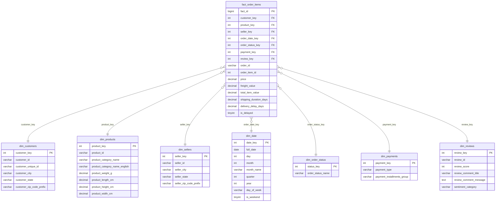

# Perancangan Skema Data Warehouse (Star Schema)

Dokumen ini disusun oleh **Anggota 1 (Data Architect & Business Analyst)** yang memuat spesifikasi arsitektur dimensional DWH, penetapan Grain, identifikasi tabel fakta dan dimensi, diagram relasi Mermaid ERD, serta kode DBML untuk visualisasi di [dbdiagram.io](https://dbdiagram.io).

---

## 1. Penetapan Grain (Granularitas Baris Data)

Prinsip metodologi Kimball menyatakan bahwa perancangan skema dimensional harus dimulai dari penetapan grain terkecil (*atomic grain*) untuk menjaga fleksibilitas agregasi analitik.

* **Pernyataan Grain**:
  > Setiap 1 baris pada tabel fakta `fact_order_items` merepresentasikan **satu unit item produk yang dibeli dalam suatu nomor pesanan transaksi unik**.

Penetapan grain pada tingkat item pesanan memungkinkan analis untuk:
* Mengukur pendapatan pada level per item produk, per kategori, per toko penjual (*seller*), dan per wilayah logistik.
* Menganalisis variasi produk berbeda yang dibeli dari penjual berbeda dalam satu keranjang belanja.

---

## 2. Klasifikasi Komponen Star Schema

### A. Tabel Fakta (Fact Table)
* **`fact_order_items`**:
  * **Surrogate Key**: `fact_id` (BIGINT AUTO_INCREMENT PRIMARY KEY).
  * **Foreign Keys**:
    * `customer_key` -> merujuk ke `dim_customers(customer_key)`
    * `product_key` -> merujuk ke `dim_products(product_key)`
    * `seller_key` -> merujuk ke `dim_sellers(seller_key)`
    * `order_date_key` -> merujuk ke `dim_date(date_key)`
    * `order_status_key` -> merujuk ke `dim_order_status(status_key)`
    * `payment_key` -> merujuk ke `dim_payments(payment_key)`
    * `review_key` -> merujuk ke `dim_reviews(review_key)`
  * **Degenerate Dimensions (DD)**:
    * `order_id` (Nomor transaksi asli dari Olist)
    * `order_item_id` (Nomor urut item dalam pesanan)
  * **Numeric Measures (Metrik Numerik)**:
    * `price` (Harga satuan produk dalam Real Brazil - BRL)
    * `freight_value` (Tarif ongkos kirim untuk item bersangkutan)
    * `total_item_value` (`price + freight_value`)
    * `shipping_duration_days` (Selisih hari penerimaan barang dikurangi tanggal beli)
    * `delivery_delay_days` (Selisih hari keterlambatan terhadap estimasi)
    * `is_delayed` (Flag biner: 1 jika terlambat, 0 jika tepat waktu)

### B. Tabel Dimensi (Dimension Tables)
1. **`dim_date`**: Dimensi kalender waktu transaksi.
   * Atribut: `date_key` (YYYYMMDD), `full_date`, `day`, `month`, `month_name`, `quarter`, `year`, `day_of_week`, `is_weekend`.
2. **`dim_customers`**: Dimensi profil pelanggan dan lokasi domisili.
   * Atribut: `customer_key`, `customer_id` (natural key), `customer_unique_id`, `customer_city`, `customer_state`, `customer_zip_code_prefix`.
3. **`dim_products`**: Dimensi katalog produk.
   * Atribut: `product_key`, `product_id` (natural key), `product_category_name`, `product_category_name_english`, `product_weight_g`, `product_length_cm`, `product_height_cm`, `product_width_cm`.
4. **`dim_sellers`**: Dimensi identitas penjual/merchant.
   * Atribut: `seller_key`, `seller_id` (natural key), `seller_city`, `seller_state`, `seller_zip_code_prefix`.
5. **`dim_order_status`**: Dimensi status pesanan (delivered, shipped, canceled, invoiced, processing, unavailable).
   * Atribut: `status_key`, `order_status_name`.
6. **`dim_payments`**: Dimensi karakteristik metode pembayaran.
   * Atribut: `payment_key`, `payment_type` (credit_card, boleto, voucher, debit_card), `payment_installments_group` (Single, 2-6x, 7-12x, >12x).
7. **`dim_reviews`**: Dimensi kepuasan dan ulasan pelanggan.
   * Atribut: `review_key`, `review_id` (natural key), `review_score` (1-5), `review_comment_title`, `review_comment_message`, `sentiment_category` (Positive, Neutral, Negative yang dihasilkan melalui AI pipeline oleh Anggota 3).

---

## 3. Diagram Visual Star Schema


### Diagram Relasi ERD (Mermaid)

Berikut adalah visualisasi hubungan tabel fakta dan dimensi dalam arsitektur Star Schema:



---

## 4. Kode DBML untuk dbdiagram.io

Untuk kemudahan visualisasi interaktif pada aplikasi [dbdiagram.io](https://dbdiagram.io), Anda dapat menyalin kode DBML di bawah ini:

```dbml
// Skema Data Warehouse Olist Brazilian E-Commerce (MySQL)
// Dibuat oleh Anggota 1 (Data Architect)

Table dim_date {
  date_key int [pk, note: 'Format YYYYMMDD']
  full_date date [not null]
  day int [not null]
  month int [not null]
  month_name varchar(20) [not null]
  quarter int [not null]
  year int [not null]
  day_of_week varchar(20) [not null]
  is_weekend tinyint [not null, default: 0]
}

Table dim_customers {
  customer_key int [pk, increment]
  customer_id varchar(50) [not null, note: 'Natural Key order customer']
  customer_unique_id varchar(50) [not null, note: 'Identitas unik individu']
  customer_city varchar(100)
  customer_state varchar(10)
  customer_zip_code_prefix varchar(10)
}

Table dim_products {
  product_key int [pk, increment]
  product_id varchar(50) [not null, note: 'Natural Key produk']
  product_category_name varchar(100)
  product_category_name_english varchar(100)
  product_weight_g decimal(10,2)
  product_length_cm decimal(10,2)
  product_height_cm decimal(10,2)
  product_width_cm decimal(10,2)
}

Table dim_sellers {
  seller_key int [pk, increment]
  seller_id varchar(50) [not null, note: 'Natural Key penjual']
  seller_city varchar(100)
  seller_state varchar(10)
  seller_zip_code_prefix varchar(10)
}

Table dim_order_status {
  status_key int [pk, increment]
  order_status_name varchar(50) [not null, unique]
}

Table dim_payments {
  payment_key int [pk, increment]
  payment_type varchar(50) [not null]
  payment_installments_group varchar(50)
}

Table dim_reviews {
  review_key int [pk, increment]
  review_id varchar(50) [not null]
  review_score int [not null]
  review_comment_title varchar(255)
  review_comment_message text
  sentiment_category varchar(50) [note: 'Output AI enrichment oleh Anggota 3']
}

Table fact_order_items {
  fact_id bigint [pk, increment]
  customer_key int [ref: > dim_customers.customer_key]
  product_key int [ref: > dim_products.product_key]
  seller_key int [ref: > dim_sellers.seller_key]
  order_date_key int [ref: > dim_date.date_key]
  order_status_key int [ref: > dim_order_status.status_key]
  payment_key int [ref: > dim_payments.payment_key]
  review_key int [ref: > dim_reviews.review_key]
  order_id varchar(50) [not null, note: 'Degenerate dimension']
  order_item_id int [not null, note: 'Degenerate dimension urutan item']
  price decimal(12,2) [not null, default: 0.00]
  freight_value decimal(12,2) [not null, default: 0.00]
  total_item_value decimal(12,2) [not null, default: 0.00]
  shipping_duration_days decimal(6,2)
  delivery_delay_days decimal(6,2)
  is_delayed tinyint [default: 0]
}
```
