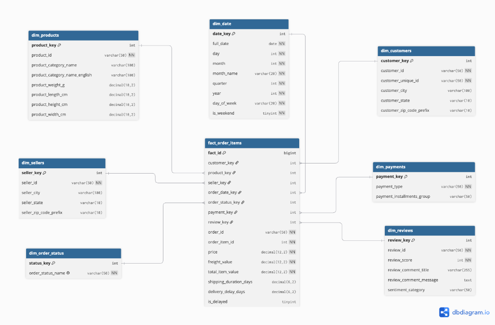
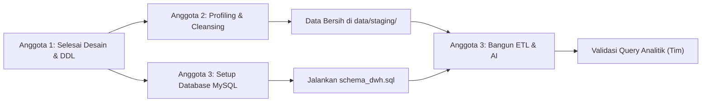

# 📊 Laporan Perkembangan Proyek (Progress Report)

* **Proyek:** Perancangan Data Warehouse & AI-assisted ETL E-Commerce
* **Dataset Sumber:** [Brazilian E-Commerce Public Dataset by Olist (Kaggle)](https://www.kaggle.com/datasets/olistbr/brazilian-ecommerce)
* **Target Database:** MySQL 8.x
* **Penyusun:** Anggota 1 (Data Architect & Business Analyst)
* **Status Proyek:** Fase 1 (Inisiasi) & Fase 2 (Desain Arsitektur) telah selesai 100%. Berkas telah didistribusikan ke grup kerja.

---

## 1. Ringkasan Progres & Deliverables yang Telah Dibagikan

Seluruh aset perancangan dari Anggota 1 telah selesai dibuat, diverifikasi, dan dibagikan ke grup tim (WhatsApp). Berikut rekapitulasi 5 poin berkas utama:

### Poin 1: Alur Proses Bisnis & 5 KPI (`docs/business_process.md`)
* Memetakan siklus transaksi e-commerce Olist: mulai dari checkout barang, konfirmasi pembayaran, penyerahan ke kurir, pengiriman tiba di pembeli, hingga pengisian ulasan kepuasan.
* Merumuskan 5 Key Performance Indicators (KPI) bisnis strategis:
  1. Tren Pendapatan Kotor Bulanan & Pertumbuhan Penjualan (MoM Growth).
  2. Rasio Ketepatan Waktu Logistik (On-Time Delivery Rate) & Rata-rata Durasi Pengiriman.
  3. Kontribusi Penjualan & Rata-rata Nilai Transaksi (AOV) per Kategori Produk.
  4. Analisis Hubungan Keterlambatan Pengiriman terhadap Skor Ulasan Pelanggan.
  5. Distribusi Metode Pembayaran & Pola Termin Cicilan (Installments).

### Poin 2: Desain Star Schema & ERD (`docs/dwh_schema_design.md` & `SKEMA DATA.png`)
* Menetapkan **Grain**: 1 baris pada tabel fakta `fact_order_items` mewakili 1 unit item produk dalam 1 nomor transaksi pesanan unik (*atomic order-item level*).
* Menghubungkan 1 tabel fakta pusat (`fact_order_items`) dengan 7 tabel dimensi (`dim_date`, `dim_customers`, `dim_products`, `dim_sellers`, `dim_order_status`, `dim_payments`, `dim_reviews`).
* Menyediakan kode DBML dan diagram ERD untuk dokumentasi visual arsitektur:



### Poin 3: Kamus Data / Data Dictionary (`docs/data_dictionary.md`)
* Memuat rincian teknis 8 tabel: tipe data MySQL, Primary Key / Surrogate Key, Foreign Key, Degenerate Dimension, aturan nilai kosong (nullable), nilai default, dan formula kolom turunan.
* Menetapkan pemetaan sumber (*source mapping*) dari file CSV mentah Kaggle agar Anggota 2 dan Anggota 3 memiliki acuan yang sama persis.
* Menyiapkan kolom `sentiment_category` pada tabel `dim_reviews` sebagai slot integrasi transformasi AI oleh Anggota 3.

### Poin 4: Skrip DDL MySQL (`sql/schema_dwh.sql`)
* Skrip SQL DDL bersih yang siap dieksekusi di database MySQL (`CREATE DATABASE dwh_olist`).
* Menggunakan standar mesin `InnoDB` dan karakter `utf8mb4`.
* Mengatur relasi *Foreign Key Constraint* (`ON DELETE RESTRICT ON UPDATE CASCADE`) serta *indexing* pada kolom kunci dan tanggal untuk optimalisasi query analitik.

### Poin 5: Skrip Query Analitik Bisnis (`sql/analytical_queries.sql`)
* Kumpulan 5 query SQL analitik tingkat lanjut yang memanfaatkan Window Function (`LAG()`, `SUM() OVER()`) dan agregasi kondisional.
* Query ini dirancang untuk langsung dijalankan setelah pipeline ETL selesai memuat data, guna membuktikan bahwa DWH mampu menjawab seluruh KPI bisnis.

---

## 2. Poin 6: Standar Struktur Folder Proyek

Agar alur kerja antar anggota berjalan teratur tanpa konflik berkas atau bentrok penamaan, struktur direktori repository `DWH BARU` diatur sebagai berikut:

```text
DWH BARU/
├── JOBDESK_DAN_WORKFLOW.md       # Panduan pembagian tugas & alur kerja tim
├── report.md                     # Laporan perkembangan berkala (dokumen ini)
│
├── docs/                         # Workspace Anggota 1 (Dokumentasi Desain & Arsitektur)
│   ├── business_process.md       # Narasi proses bisnis & definisi KPI
│   ├── dwh_schema_design.md      # Desain Star Schema, Grain, dan ERD
│   └── data_dictionary.md        # Kamus data teknis seluruh tabel DWH
│
├── sql/                          # Workspace Anggota 1 & Anggota 3 (Skrip Database)
│   ├── schema_dwh.sql            # DDL inisialisasi tabel target MySQL
│   └── analytical_queries.sql    # Query SQL analitik untuk pengujian KPI
│
├── data/                         # Direktori Penyimpanan Dataset
│   ├── raw/                      # Wadah CSV mentah hasil unduhan dari Kaggle (Olist)
│   └── staging/                  # Wadah CSV/Parquet bersih hasil olahan Anggota 2
│
└── src/                          # Direktori Kode Program
    ├── cleansing/                # Workspace Anggota 2 (Jupyter Notebook / Python Cleansing)
    │   ├── data_profiling.ipynb  # Audit kondisi kotoran data awal
    │   └── cleansing.py          # Skrip otomatisasi pembersihan data
    │
    └── etl/                      # Workspace Anggota 3 (Pipeline ETL & Modul AI)
        ├── ai_transformer.py     # Modul enrichment AI (analisis sentimen ulasan)
        ├── etl_pipeline.py       # Pipeline Extract, Transform, dan Load ke MySQL
        └── database_config.py    # Konfigurasi koneksi database MySQL
```

### Panduan Penggunaan Folder bagi Setiap Anggota:
1. **Folder `data/raw/`**: Tempat menaruh file CSV asli dari Kaggle. Folder ini tidak boleh diubah isinya secara manual untuk menjaga orisinalitas data mentah.
2. **Folder `data/staging/`**: Anggota 2 menyimpan file dataset yang sudah bersih di sini. File di folder inilah yang akan dibaca oleh skrip ETL Anggota 3.
3. **Folder `src/cleansing/`**: Anggota 2 meletakkan seluruh file kode analisis data kotor dan script pembersihan di folder ini.
4. **Folder `src/etl/`**: Anggota 3 meletakkan seluruh kode pipeline integrasi database, modul AI, dan logging proses loading di folder ini.

---

## 3. Langkah Lanjutan & Pembagian Tugas (Next Action Items)

Dengan selesainya seluruh deliverable Anggota 1, tongkat estafet proyek kini berada di tangan Anggota 2 dan Anggota 3 untuk pengerjaan fase berikutnya:



### A. Tindakan Segera untuk Anggota 2 (Data Quality & Cleansing Engineer):
1. **Unduh Dataset**: Ambil dataset Olist dari Kaggle dan simpan seluruh CSV ke folder `data/raw/`.
2. **Audit Kualitas (Profiling)**: Cek missing values pada kolom ulasan (`review_comment_message`), format tanggal pada tabel orders, dan duplikasi data.
3. **Pembersihan Data**:
   * Sesuaikan nama kolom hasil pembersihan dengan acuan di [`docs/data_dictionary.md`](docs/data_dictionary.md).
   * Gabungkan nama kategori produk bahasa Portugis dengan terjemahan bahasa Inggris (`product_category_name_translation.csv`).
   * Standarisasi format tanggal menjadi `YYYY-MM-DD HH:MM:SS`.
   * Bersihkan format teks kota dan kode negara bagian (*state*).
4. **Ekspor Data Bersih**: Simpan data hasil pembersihan ke folder `data/staging/`.

### B. Tindakan Segera untuk Anggota 3 (ETL & Database Engineer):
1. **Setup Database**:
   * Siapkan server MySQL lokal (MySQL 8.x via Docker, MySQL Workbench, XAMPP, atau CLI).
   * Buat database baru: `CREATE DATABASE dwh_olist;`.
2. **Inisialisasi Skema**:
   * Jalankan berkas [`sql/schema_dwh.sql`](sql/schema_dwh.sql) untuk membentuk tabel dimensi dan tabel fakta secara otomatis.
3. **Bangun Modul AI**:
   * Buat modul Python di `src/etl/ai_transformer.py` untuk mengklasifikasikan sentimen kolom ulasan pembeli (`Positive`, `Neutral`, `Negative`) guna mengisi kolom `sentiment_category` pada tabel `dim_reviews`.
4. **Bangun Pipeline ETL**:
   * Ekstraksi data dari `data/staging/`.
   * Bentuk *Surrogate Keys* dan relasikan kunci ke tabel fakta `fact_order_items`.
   * Muat data (*Load*) ke MySQL secara bertahap (tabel dimensi terlebih dahulu, baru tabel fakta).

### C. Tindakan Akhir Bersama (Testing & Laporan Akhir):
* Setelah data terisi di MySQL, jalankan skrip [`sql/analytical_queries.sql`](sql/analytical_queries.sql) bersama-sama untuk memvalidasi output insight bisnis.
* Susun laporan akhir dan slide presentasi proyek berdasarkan seluruh dokumen yang telah dirapikan.
